<p align="center">
  
</p>

<p align="center">
  <a href="https://github.com/whycorporation/whycodes/actions/workflows/ci.yml"></a>
  <a href="https://github.com/whycorporation/whycodes/releases"></a>
  <a href="LICENSE"></a>
  <a href="https://discord.gg/H2KsKYEdT8"></a>
</p>

<p align="center">
  English · <a href="README.zh-CN.md">简体中文</a> · <a href="README.ru.md">Русский</a> · <a href="README.es.md">Español</a>
</p>

**A fast, provider-independent coding agent for the terminal, written in Rust.**

WhyCodes reads, writes and edits files, runs commands, searches the workspace
and drives an LLM through multi-turn tool use — in a full-screen TUI or as a
machine-readable one-shot CLI. It focuses on a small native footprint, an
idle-efficient TUI, and a workflow that is not tied to any single model
provider.

<p align="center">
  
</p>

## Why WhyCodes

- **Starts instantly.** `whycodes --version` returns in 1.4 ms on Linux.
- **Costs nothing while idle.** The TUI paints only when something changes:
  an idle session draws 0 frames per second.
- **Stays small.** Ten idle sessions share 41.9 MB, about 3.1 MB for each
  extra one; a resumed 3000-message session holds 34.7 MB.
- **Works with the model you choose.** Hosted APIs, a local model server, or
  any OpenAI-compatible endpoint — switch per run or mid-session.

Measured on one machine; method and caveats under [Performance](#performance).

## Highlights

- **One native binary.** Nothing else to install: search runs in-process, and
  on Windows commands run without WSL (through Git for Windows when present,
  otherwise an embedded bash-compatible shell).
- **Cross-platform.** The same workflow on Linux, macOS and Windows.
- **Any provider.** Anthropic, OpenAI, Google, GitHub Copilot, Groq, xAI,
  DeepSeek, Ollama, OpenRouter, Mistral, Together, local servers such as
  LM Studio, vLLM and llama.cpp, or any OpenAI-compatible endpoint.
- **Fits your project.** Loads project instructions from `AGENTS.md` and
  connects to existing MCP tools and language servers over LSP.
- **Remembers your work.** Persisted sessions you can branch and resume,
  cross-session memory (`MEMORY.md`, semantic recall) and an optional code index.

## Installation

### Install script (Linux, macOS)

```bash
curl -fsSL https://why.codes/install | bash
```

### Install script (Windows)

```powershell
irm https://why.codes/install.ps1 | iex
```

Adds `%LOCALAPPDATA%\Programs\whycodes` to your user PATH. No WSL required.

### Homebrew (macOS; Linuxbrew x86_64)

```bash
brew tap whycorporation/whycodes https://github.com/whycorporation/whycodes
brew install whycorporation/whycodes/whycodes
```

<details>
<summary>Homebrew says the tap is untrusted</summary>

Homebrew 6+ refuses untrusted third-party taps. The fully-qualified install
above trusts only this formula. If you already tapped and saw that error:

```bash
brew trust --formula whycorporation/whycodes/whycodes
brew install whycodes
```

</details>

### From source

```bash
# Needs libsqlite3 (pkg-config). For a fully static binary:
# cargo build --release -p whycodes-cli --features bundled-sqlite
cargo build --release -p whycodes-cli
```

Update with `whycodes upgrade` (script / cargo installs) or `brew upgrade
whycodes` (Homebrew). Interactive TUI sessions check GitHub for a newer
release and ask on the home screen before installing; pass
`--no-auto-update` to skip the check. The install scripts verify release
artifacts against the published `SHA256SUMS`. Downloadable binaries and
uninstall instructions: [docs/packaging.md](docs/packaging.md). How Windows
release binaries are signed: [Code signing policy](docs/code-signing-policy.md).

Config and sessions live in `~/.whycodes` (`%USERPROFILE%\.whycodes` on
Windows), or `$WHYCODES_HOME` when set.

<details>
<summary>Upgrading from 0.6.4 or earlier</summary>

0.6.5 moved config and sessions out of the platform directory used before
(`~/.config/whycodes` or `~/.config/com.whycorporation.whycodes` on Linux,
`~/Library/Application Support/com.whycorporation.whycodes` on macOS,
`%APPDATA%\whycorporation\whycodes` on Windows). The first launch copies
`config.toml`, `auth.json`, and `whycodes.db` across when the new directory
is empty, and leaves the old files in place.

</details>

<details>
<summary>Shell completions</summary>

```bash
eval "$(whycodes completions zsh)"    # ~/.zshrc
eval "$(whycodes completions bash)"   # ~/.bashrc
whycodes completions fish > ~/.config/fish/completions/whycodes.fish
```

</details>

## Quick start

```bash
export ANTHROPIC_API_KEY="sk-ant-..."

whycodes -d ./my-project                            # interactive TUI
whycodes generate "Explain main.rs" -d ./my-project # one-shot
whycodes generate "Summarize the last commit" --format json
whycodes --continue                                 # resume last session
whycodes -P openai -m gpt-5 generate "Refactor this module"
```

No API key? Run a model locally:

```bash
whycodes -P ollama -m qwen2.5-coder               # Ollama
whycodes provider discover --save                 # finds LM Studio, vLLM, llama.cpp
```

Subscription OAuth login (`whycodes auth login <provider>`) is available
only after installing a local `kind: "auth"` plugin — WhyCodes ships no
third-party OAuth clients. See [docs/auth.md](docs/auth.md).

The full guide — CLI reference, TUI keys, slash commands, agents, tools and
configuration — is in **[docs/guide.md](docs/guide.md)**.

## Features

| | |
|---|---|
| **Agents** | `build` (full access), `plan` and `ask` (read-only), and `whycodes`, which explains and repairs its own config; `general`, `explore` and `scout` subagents via the `task` tool, optionally returning a typed result; parallel workers in git worktrees via `swarm`, watched and steered from the agent hub (`/agents`) |
| **Models** | Prewalk plans a turn on a strong model and hands the edits to a cheaper one; switch provider or model per run or mid-session (`/models`); opt-in provider-native compaction for Anthropic |
| **Tools** | File edit/patch, Jupyter notebooks as cells, in-process search, shell, git and GitHub, web fetch/search, a CDP-driven browser, background jobs with `wait`, scheduling and to-do tracking; `ast_grep` / `ast_edit` in builds with the `ast-tools` feature |
| **Sessions** | Persisted per project; resume with `--continue` / `--resume`, branch and revisit earlier turns with `/branch` and `/tree`, import transcripts from other agent CLIs, share over the local server |
| **Steering** | Queue a message for after the turn (`/queue`) or interrupt between tool calls (`/now`); stream rules that interrupt the model when its output matches (`whycodes rules`) |
| **Memory** | Human-editable `MEMORY.md`, semantic facts with embeddings, optional code RAG index — all per project, all optional |
| **Headless / CI** | `generate` with `--format json` or `stream-json` (NDJSON), multiple prompts run concurrently, non-zero exit on failure; `whycodes slop` reports ΔLOC / verbosity / erosion on the diff |
| **Safety** | Approval presets (`--approval-mode auto\|important\|manual`), permission gates per tool, shell command risk analysis, an optional OS sandbox (bubblewrap), HTTP domain allowlists and tool hooks |
| **Extensibility** | MCP servers (stdio and HTTP), LSP language servers, skills, shell plugins, custom slash commands, themes |
| **Embedding** | Rust and TypeScript SDKs over daemon protocol v1 (`whycodes serve`) |

## Performance

Measured 2026-10-16 on one machine (Ryzen 7 3800X): Windows 11 natively
and Linux under WSL2. Method, older runs and caveats in
[docs/benchmarks.md](docs/benchmarks.md):

| Metric | Windows | Linux (WSL2) |
|---|---|---|
| `--version` | **12.9 ms** | **1.4 ms** |
| First frame (harness, in-proc) | **0.25 ms** | **0.08 ms** |
| Idle redraws (3 s) | **0.0 /s** | **0.0 /s** |
| 1 idle session PSS | — (`/proc` only) | **13.6 MB** |
| 10 idle sessions PSS | — | **41.9 MB** (~3.1 MB each extra) |
| Resumed 3000-message session PSS | — | **34.7 MB** |

The TUI paints only when something changed, so an idle session draws
nothing. A resumed 3000-message transcript holds 34.7 MB, down from
216 MB before the October memory work. The first-frame harness times one
splash paint, not the full home screen.

CI fails below 98.5% workspace line coverage and holds twenty-four crates
at 100% production-code line coverage — see [docs/coverage.md](docs/coverage.md).

## Documentation

| Doc | What it covers |
|---|---|
| [docs/guide.md](docs/guide.md) | Usage: CLI, TUI, agents, tools, config, SDK |
| [docs/tools/](docs/tools/README.md) | One page per built-in tool |
| [docs/config.md](docs/config.md) | Every config key with default and env override |
| [docs/providers.md](docs/providers.md) | Provider catalogue: quirks, auth, model handling |
| [docs/auth.md](docs/auth.md) | API keys, OAuth, credential import |
| [docs/architecture.md](docs/architecture.md) | Crate map and layering |
| [docs/internals/](docs/internals/) | Turn loop, permission gate, compaction, prompt cache, retry, MCP |
| [docs/roadmap.md](docs/roadmap.md) | Current focus and deferred work |
| [docs/knowhow.md](docs/knowhow.md) | Hard-won bugs (TUI, tty, silent exits) |
| [docs/tui-term-matrix.md](docs/tui-term-matrix.md) | Manual TUI pass on Alacritty / Kitty / VTE |
| [docs/benchmarks.md](docs/benchmarks.md) | Measuring startup, RSS, idle draws |
| [docs/coverage.md](docs/coverage.md) | Measuring line coverage |
| [docs/budgets.md](docs/budgets.md) | CI quality budgets |
| [docs/packaging.md](docs/packaging.md) | Homebrew, installers, release download counts |
| [docs/code-signing-policy.md](docs/code-signing-policy.md) | Code signing policy |

## Contributing

Contributions are welcome. [CONTRIBUTING.md](CONTRIBUTING.md) is the short
path from clone to a merged change; [AGENTS.md](AGENTS.md) holds the rules
for coding agents working in this repo. By participating you agree to the
[Code of Conduct](CODE_OF_CONDUCT.md). Help and bug reports: [SUPPORT.md](SUPPORT.md).
Please report vulnerabilities through [SECURITY.md](SECURITY.md), not public
issues.

## Community

<p>
  <a href="https://discord.gg/H2KsKYEdT8"></a>
  <a href="https://t.me/whycodesai"></a>
  <a href="https://x.com/whycodesai"></a>
  <a href="https://www.youtube.com/@whycodesai"></a>
  <a href="https://olud.ai/tool/whycodes.html"></a>
</p>

Website: [why.codes](https://why.codes).

## Sponsors

WhyCodes is independently developed and needs funding to keep shipping.
Sponsor the project on [GitHub Sponsors](https://github.com/sponsors/whycorporation).

<a href="https://github.com/sponsors/whycorporation"></a>

## Star History

<p align="center">
  <a href="https://www.star-history.com/?repos=whycorporation%2Fwhycodes&type=date&legend=top-left">
    <picture>
      <source media="(prefers-color-scheme: dark)" srcset="https://api.star-history.com/chart?repos=whycorporation/whycodes&type=date&theme=dark&legend=top-left" />
      <source media="(prefers-color-scheme: light)" srcset="https://api.star-history.com/chart?repos=whycorporation/whycodes&type=date&legend=top-left" />
      
    </picture>
  </a>
</p>

## License

[MIT](LICENSE)
